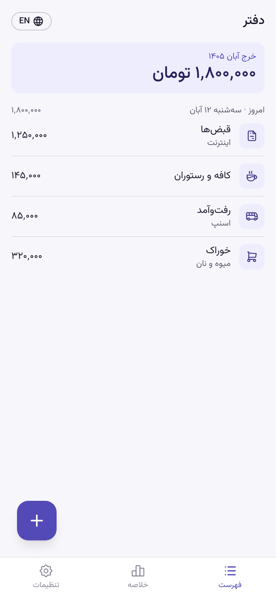
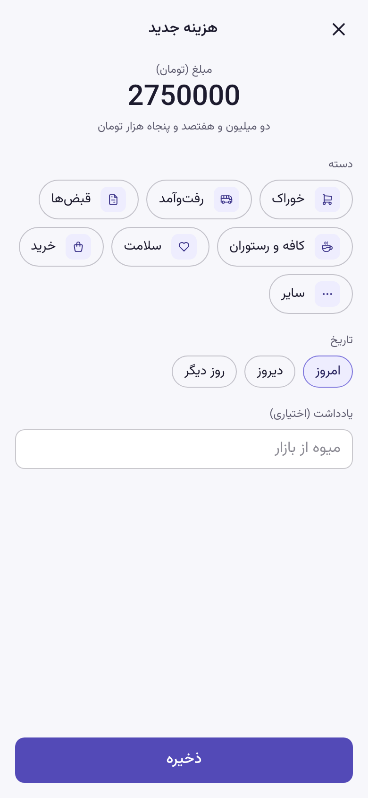
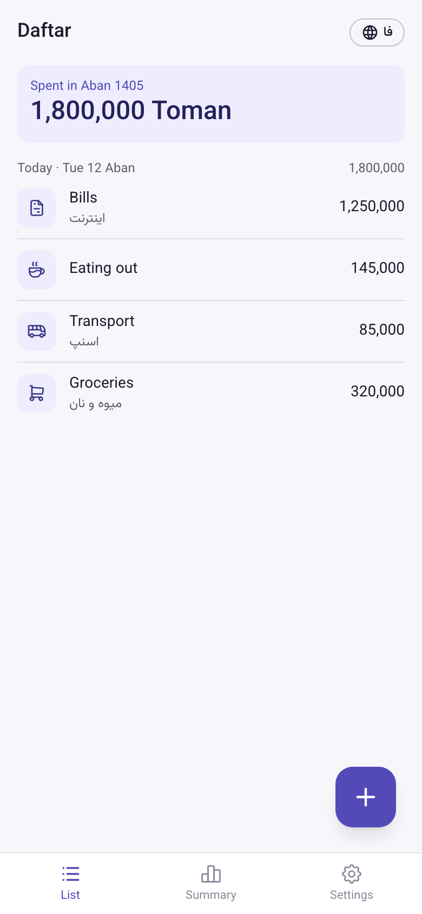
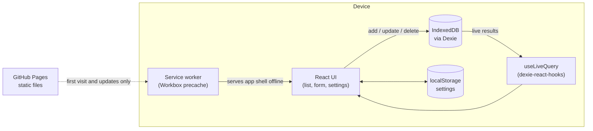

# Daftar · دفتر

An offline-first expense tracker for the phone, with Jalali dates and Toman amounts. Install it once and it works with no internet at all. There is no server, and your data never leaves the device.

[](https://github.com/atefeh-sa93/daftar/actions/workflows/ci.yml)
[](https://github.com/atefeh-sa93/daftar/actions/workflows/deploy.yml)

**Live demo:** https://atefeh-sa93.github.io/daftar/. Open it once, install it, then turn on airplane mode.

<p>
  
  
  
</p>

## The problem

Most expense apps need an account, a server, and a stable connection. Many of them also get Persian users wrong: they use the Gregorian calendar, Rial instead of Toman, Latin digits, or a layout that breaks in right-to-left. I wanted something that opens instantly, works on a bad connection or none, and feels native in Persian. Writing down a ۸۵٬۰۰۰ تومان taxi ride should take five seconds.

## Features

- **Works fully offline.** After the first visit, the whole app (HTML, JS, CSS, font, icons) is served from the cache. You can reload, add, edit, and delete with the network off.
- **Installable.** It installs as a real app on Android and as a home screen app on iOS, with its own icon and a standalone window.
- **Jalali dates and Toman amounts.** You see Persian month names and digits, plus the amount spelled out in words (`دو میلیون و هفتصد و پنجاه هزار تومان`) to catch extra zeros.
- **Bilingual: Persian (RTL) and English (LTR).** The language is detected from the browser and can be switched from any page. The calendar (Jalali or Gregorian) is a separate setting.
- **Fast entry.** The form needs an amount, a category chip, and a date (Today, Yesterday, or another day), with an optional note.
- **Delete with undo.** A deleted expense can be brought back for a few seconds.
- **Safe updates.** A new version never reloads the page on its own. You get a prompt, and it never appears while you are filling in the form.
- **Durable storage.** After the first expense, the app asks the browser to keep its data even when disk space runs low. Settings shows whether that was granted.
- **Offline badge.** The header shows when you are offline, in text as well as color.

Coming in [milestone M3](https://github.com/atefeh-sa93/daftar/milestones): monthly summary with a category chart, and JSON/CSV backup.

## Architecture



There is no backend. IndexedDB is the single source of truth, and components read from it through live queries, so a write anywhere shows up everywhere without a state library.

```
src/
  app/        shell, routes (hash-based), bottom nav, settings store
  db/         Dexie schema, default categories
  features/
    expenses/ list, form, undo, data hooks
    summary/  monthly summary (M3)
    settings/ language, calendar, storage status, version
  lib/        money parsing and formatting, Jalali dates, number to words, i18n strings
  pwa/        update prompt, offline badge, persistent storage
tests/unit/   Vitest tests for lib, db, and stores
```

## Technical decisions

- **Money is an integer number of Toman.** It is never a float, so there are no rounding errors. `parseAmount` accepts Persian, Arabic, and Latin digits and thousands separators, and rejects decimals and negative numbers.
- **Dates are stored as ISO `YYYY-MM-DD` (Gregorian).** Jalali is only a display layer, built on `jalaali-js`. This keeps sorting, indexing, and month ranges simple, and makes backups readable by other tools.
- **No state library.** Dexie and `useLiveQuery` already give reactive reads from the database. Settings are a small `useSyncExternalStore` over localStorage, read before the first render so the page never flashes in the wrong language or direction.
- **Updates are controlled by the user.** The service worker uses `registerType: 'prompt'`. A new version waits until the user taps Reload, and the prompt is hidden on the form so a half-typed expense is never lost. The app checks for updates hourly while online.
- **Cache strategy.** The Workbox `generateSW` precaches the built app shell: 16 files, including the self-hosted Vazirmatn font. Navigation falls back to the cached `index.html`, and outdated caches are cleaned up. Nothing is fetched from a CDN at runtime.
- **Hash routes** (`#/add`, `#/settings`). GitHub Pages has no SPA fallback, so a deep link like `/daftar/add` would return 404 there.
- **Relative manifest paths.** `start_url`, `scope`, and `id` are `./`, so the same build works under `/daftar/`.
- **Accessibility.** Status is never shown by color alone. Live regions announce the offline state and undo, and animations respect `prefers-reduced-motion`.

## Known limitations

- **Data lives on one device.** There is no sync. If you clear the browser data or lose the phone, the data is gone. JSON backup (#18) is the planned answer.
- **Android installs need Google's servers.** Chrome builds the installed app (a WebAPK) through Google. When that is blocked, or Play Services are missing, Chrome quietly adds a plain shortcut with a Chrome badge instead. Offline still works in that case.
- **iOS** has no install prompt. You have to use Share → Add to Home Screen, and Safari may clear storage for sites that are not added to the home screen.
- **Categories are fixed** to the seven defaults for now.
- **Expenses only.** There is no income or budget yet.

## How I used AI

I built this with [Claude Code](https://claude.com/claude-code) as a pair programmer.

- I wrote the design doc, the scope, and the three-day plan. That plan became the GitHub [issues and milestones](https://github.com/atefeh-sa93/daftar/milestones).
- For each issue, Claude wrote the code and tests on a separate branch and opened a pull request that closes the issue.
- I reviewed and merged every PR myself.
- Design choices were made together and checked against current UX guidance: bilingual support, the indigo palette, no flags for languages, and a header language button instead of a picker screen.
- Behavior that unit tests cannot see was checked with throwaway Playwright scripts: offline reload, the update flow, and persistent storage. I tested installing and using the app in airplane mode on a real Android phone.

## Run locally

Requires Node 22+ and pnpm (the version is pinned in `package.json`).

```bash
pnpm install
pnpm dev                     # http://localhost:5173/
pnpm build && pnpm preview   # http://localhost:4173/daftar/, same as the live site
```

The service worker only runs in the production build, so test offline behavior with `pnpm preview`.

```bash
pnpm test        # Vitest unit tests (fake-indexeddb for the database)
pnpm test:e2e    # Playwright against the production build: offline, backup, manifest
pnpm lint        # oxlint
pnpm typecheck   # tsc, strict
```

The first time, `pnpm exec playwright install chromium` downloads the browser for the E2E tests.

CI runs lint, typecheck, unit tests and build, and the E2E suite in a separate job, on every pull request. Every push to `main` deploys to GitHub Pages.

## Roadmap

- [x] M0: project setup, CI, deploy
- [x] M1: add, edit, delete, and list expenses, with Jalali dates
- [x] M2: offline PWA, install, update prompt, persistent storage, real device test
- [ ] M3: monthly summary and chart, JSON/CSV backup, Playwright E2E in CI, accessibility audit, v1.0.0
- Later: monthly budget, dark mode, optional sync between devices
